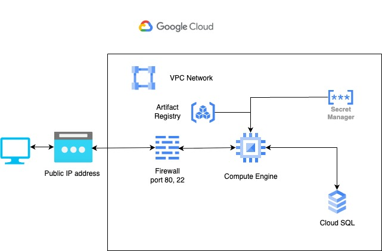

## PoC FastAPI + Docker + GCP + Terraform for finitec company

  

### Purpose
Showing what my code looks like, how I write unit and integration tests, how I use FastAPI framework and my approach to architecture.

### What is in repository
1. FastAPI web application with unit tests for one service and integration test for one router
2. Dockerfiles with docker-compose.yml to develop locally
3. Terraform with infrastructure on GCP

### Architecture

  

### Run on dev with docker-compose
1. Go to `fastapi_docker_gcp_terraform` directory
2. Create `.env` file from `.env.template` file
3. Set `ENVIRONMENT` variable to `development` in  `.env` file
4. Run `docker-compose up -d` command
5. Open docker container cli and go to `/usr/src/app/scripts/`
6. Execute script using `python -b initialize_database_schema.py` command
7. Execute script using `python -b insert_stock_data.py` command
8. Open browser and go to: `http://localhost:8080/docs` 

### Run on GCP
1. Install GCP SDK
2. Create GCP Project
3. Go to `fastapi_docker_gcp_terraform` directory
4. Open and edit variables in `build_and_publish_image_to_gcp.sh`
5. Execute `chmod +x build_and_publish_image_to_gcp.sh` command
6. Go to `infrastructure` directory
7. Edit variables in `variables.tf` file to match your project id
8. Execute `terraform init` command
9. Execute `terraform plan` command
10. Execute `terraform apply` command
11. Connect to created VM via SSH
12. Execute `sudo docker ps` command and copy container ID
13. Execute `sudo docker exec -it 594d85718ad9 python -b /usr/src/app/scripts/initialize_database_schema.py` command
14. Execute script using `sudo docker exec -it {your_container_id} python -b /usr/src/app/scripts/insert_stock_data.py` command 
15. Go to `{your_ip_address}/welcome` page

### Notes for run on GCP

